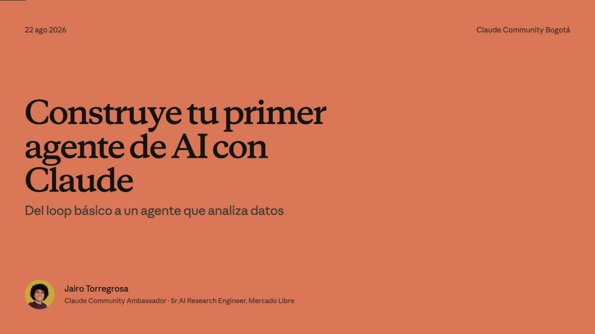
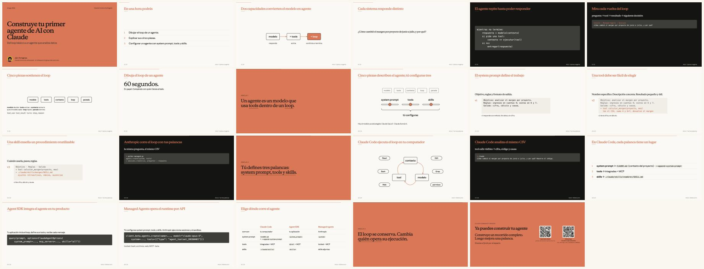

<!-- ficha:inicio · lo escribe scripts/catalogo.py desde charlas.toml · no lo edites a mano -->
# Construye tu primer agente de AI con Claude

<table>
<tr><td>📅 <b>Cuándo</b></td><td>22 de agosto de 2026</td></tr>
<tr><td>📍 <b>Dónde</b></td><td>Oficinas de Quick · Bogotá</td></tr>
<tr><td>🎤 <b>Formato</b></td><td>Charla · 1 h</td></tr>
<tr><td>🎟️ <b>Evento</b></td><td><a href="https://luma.com/claude-imxl">Claude Community Bogotá · hackathon de analítica con Quick</a></td></tr>
<tr><td>📑 <b>Deck</b></td><td><a href="Construye-tu-primer-agente-Bogota-2026.pdf">23 slides en PDF</a> · <a href="https://github.com/JairoTorregrosa/charlas/raw/main/2026-agents-bogota/Construye-tu-primer-agente-Bogota-2026.pdf">descargar</a></td></tr>
<tr><td>🧪 <b>Demo</b></td><td><a href="demo">demo/</a> · <a href="notebooks">notebooks/</a> · <a href="hackathon">hackathon/</a></td></tr>
</table>

👀 Las 23 slides de un vistazo

<a href="../README.md">← Todas las charlas</a> · anterior: <a href="../2026-hapgj/">Crea tu Web con IA</a> · siguiente: <a href="../2026-casanare-marley/">Mi agente personal: la IA que crece contigo</a>
<!-- ficha:fin -->

Charla de apertura del *Bogotá | Claude Workshop | AI Agents for business analytics competition* (Claude Community Bogotá, oficinas de Quick, 22 de agosto de 2026). Una hora: qué es un agente, cómo piensa por dentro, las tres palancas (system prompt, tools, contexto) y dónde corre hoy con el stack de Claude.

## Qué hay aquí

| Carpeta | Qué es |
|---|---|
| [`Construye-tu-primer-agente-Bogota-2026.pdf`](Construye-tu-primer-agente-Bogota-2026.pdf) | El deck tal como se proyectó: 23 páginas, 16:9 |
| [`demo/`](demo/) | Las demos: `agent.py` (el loop en ~100 líneas, Messages API), `managed.py` (Managed Agents), `CLAUDE.md` (contexto para Claude Code), `contabilidad.csv` (sintético) y el `RUNBOOK.md` con los comandos exactos |
| [`hackathon/`](hackathon/) | Instrucciones del reto: las 7 preguntas, convenciones contables, cómo entregar respuesta + traza y cómo se puntúa. Leaderboard: <https://quick-golden-bench.vercel.app> |
| [`notebooks/`](notebooks/) | Cuatro notebooks ejecutados, una palanca por celda: Messages API, Claude Agent SDK, `claude -p`, Managed Agents. Mismo CSV, mismo modelo (`claude-sonnet-5`), salidas reales |

## La pregunta que resuelven todos
> ¿Cómo cambió el margen por proyecto de junio a julio, y por qué?

Sobre `contabilidad.csv` (PUC colombiano, `;` y decimal con coma): ingresos en cuentas 4, costos en 6 y 7. La historia plantada: el proyecto 2210 sube ~10 pp, el 1045 baja ~22 pp (nómina), el 3322 queda plano.

## Correr
- Demos y notebooks: `export ANTHROPIC_API_KEY=...` (y `MANAGED_ENV_ID=env_...` para Managed Agents, se crea en la Console). Notebooks: `cd notebooks && uv sync && uv run jupyter lab`.

Comunidad: grupo de WhatsApp *Claude Code Colombia* (QR en la última slide).
