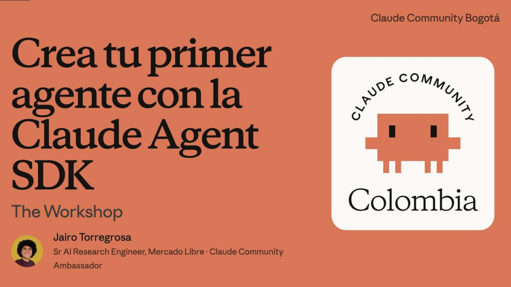
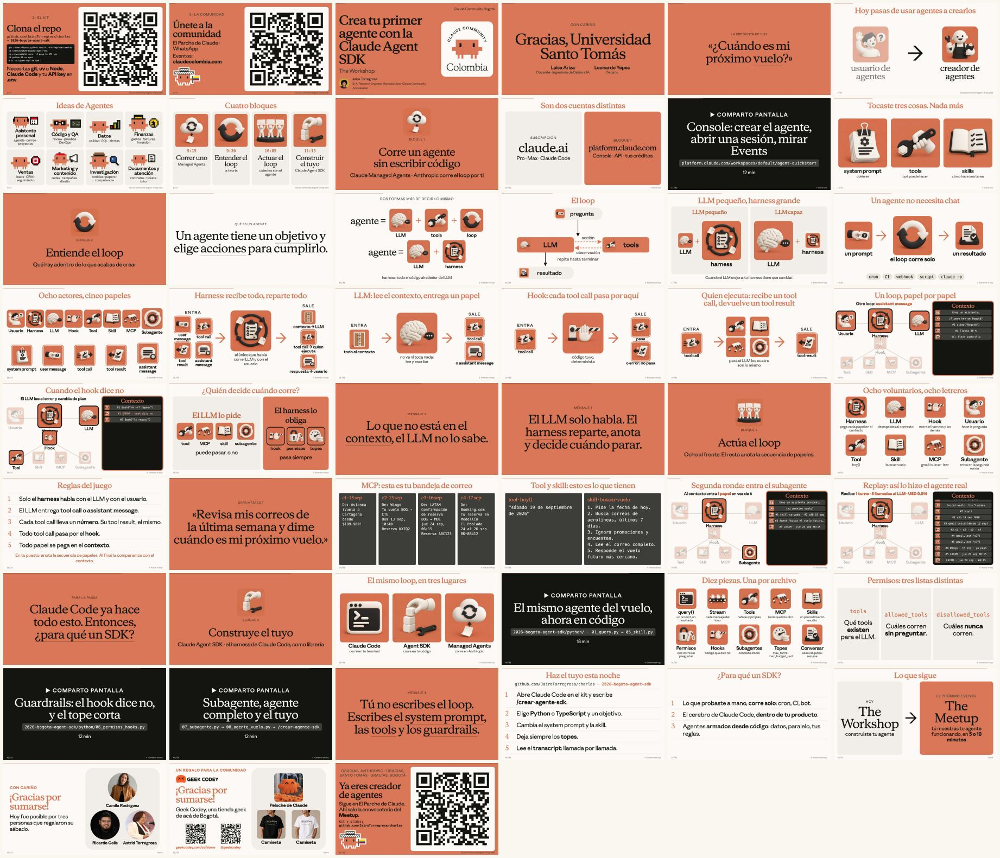

<!-- ficha:inicio · lo escribe scripts/catalogo.py desde charlas.toml · no lo edites a mano -->
# Crea tu primer agente con la Claude Agent SDK

<a href="Crea-tu-primer-agente-Agent-SDK-Bogota-2026.pdf"></a>

<table>
<tr><td>📅 <b>Cuándo</b></td><td>19 de septiembre de 2026</td></tr>
<tr><td>📍 <b>Dónde</b></td><td>Universidad Santo Tomás · Bogotá</td></tr>
<tr><td>🎤 <b>Formato</b></td><td>Workshop · 3,5 h</td></tr>
<tr><td>🎟️ <b>Evento</b></td><td><a href="https://luma.com/claude-be23">Claude Community Bogotá · Claude Fest Colombia</a> · Luma</td></tr>
<tr><td>📑 <b>Deck</b></td><td><a href="Crea-tu-primer-agente-Agent-SDK-Bogota-2026.pdf">51 slides en PDF</a> · <a href="https://github.com/JairoTorregrosa/charlas/raw/main/2026-bogota-agent-sdk/Crea-tu-primer-agente-Agent-SDK-Bogota-2026.pdf">descargar</a></td></tr>
<tr><td>🧪 <b>Demo</b></td><td><a href="python">python/</a> · <a href="typescript">typescript/</a> · <a href="managed-agents">managed-agents/</a></td></tr>
<tr><td>🛠️ <b>Skill</b></td><td><a href=".claude/skills/crear-agente-sdk"><code>crear-agente-sdk</code></a></td></tr>
</table>

<details>
<summary>👀 Las 51 slides de un vistazo</summary>

<a href="Crea-tu-primer-agente-Agent-SDK-Bogota-2026.pdf"></a>

</details>

<sub><a href="../README.md">← Todas las charlas</a> · anterior: <a href="../2026-platzi-agent-sdk/">Crea tu primer agente con Claude Agent SDK</a> · siguiente: <a href="../2026-lasalle-managed-agents/">Agentes en la nube con Claude Managed Agents</a></sub>
<!-- ficha:fin -->

Un solo hilo, **un asistente de viaje**, y siempre la misma pregunta:

> Revisa mis correos de la última semana y dime cuándo es mi próximo vuelo.

En `01` el modelo contesta que no puede. En `08` contesta: jueves 24 de septiembre de 2026, 06:15, BOG → MDE, LATAM, reserva ABC123. La [edición de noviembre](../2026-javeriana-agent-sdk/) suma una pieza más, la salida estructurada.

## El recorrido: una pieza por archivo

| # | Pieza | Qué aparece | Código |
|---|---|---|---|
| 01 | `query()` | Un prompt entra, una respuesta sale, el proceso termina. Sin tools no puede. | [py](python/01_query.py) · [ts](typescript/01_query.ts) |
| 02 | el stream | Todo lo que pasa adentro: arranque, tool call, tool result, texto, recibo. | [py](python/02_stream.py) · [ts](typescript/02_stream.ts) |
| 03 | tool propia | `hoy()`: una función tuya que el LLM decide llamar. | [py](python/03_tool.py) · [ts](typescript/03_tool.ts) |
| 04 | MCP | Un servidor de correo falso en otro proceso. Tools que no escribiste tú. | [py](python/04_mcp.py) · [ts](typescript/04_mcp.ts) |
| 05 | skill | El procedimiento en markdown. Se carga cuando se usa, no antes. | [py](python/05_skill.py) · [ts](typescript/05_skill.ts) |
| 06 | permisos y hooks | Quién decide si una tool corre. El `deny` no tumba al agente. | [py](python/06_permisos_hooks.py) · [ts](typescript/06_permisos_hooks.ts) |
| 07 | subagente | Contexto aparte, un solo resultado de vuelta. | [py](python/07_subagente.py) · [ts](typescript/07_subagente.ts) |
| 08 | todo junto | Con topes de turnos y de dinero, y la bitácora en `salidas/<fecha-hora>/`. | [py](python/08_agente_vuelo.py) · [ts](typescript/08_agente_vuelo.ts) |
| 09 | conversar | El contraste: conversar es una función más y hay que pedirla. | [py](python/09_conversar.py) · [ts](typescript/09_conversar.ts) |
| ☁️ | Managed Agents | El mismo asistente sin harness tuyo: el loop lo corre Anthropic. | [`managed-agents/`](managed-agents/) |

El mismo recorrido en una sola pantalla: [`python/notebook.ipynb`](python/notebook.ipynb).

## Córrelo

```
git clone https://github.com/JairoTorregrosa/charlas
cd charlas/2026-bogota-agent-sdk
cp .env.example .env          # pega tu API key
cd python && uv sync          # o: cd typescript && npm install
uv run python 01_query.py     # o: npm run 01
```

Sigue con [`python/README.md`](python/README.md) o [`typescript/README.md`](typescript/README.md).

```
2026-bogota-agent-sdk/
├── python/           el recorrido completo, un archivo por pieza, más el notebook
├── typescript/       el mismo recorrido, en TypeScript
├── managed-agents/   el mismo asistente sin harness tuyo: lo corre Anthropic
└── .claude/skills/   la skill del taller para tu propio Claude Code
```

<details>
<summary>Requisitos</summary>

| Para qué | Qué necesitas |
|---|---|
| `python/` y `typescript/` | Claude Code instalado y con sesión iniciada (`claude` → `/login`) |
| `python/` | [uv](https://docs.astral.sh/uv/) |
| `typescript/` | Node 20.11 o más |
| `managed-agents/` | cuenta de Console y API key (la suscripción de claude.ai no sirve) |
| todo | git |

</details>

<details>
<summary>Tu API key y la autenticación</summary>

```
cp .env.example .env      # en la raíz del kit
```

Pega tu key en `ANTHROPIC_API_KEY=`. Se crea en [platform.claude.com/settings/keys](https://platform.claude.com/settings/keys) → «Create Key», en la misma cuenta de Console donde redimiste los créditos. La suscripción de claude.ai (Pro o Max) no trae API key. La leen `python/`, `typescript/` y `managed-agents/`; cada script imprime `[auth]` con la autenticación que quedó. `.env` está en `.gitignore`. Sin key, `python/` y `typescript/` usan la sesión de Claude Code de tu máquina.

En el taller usamos la sesión de Claude Code porque es lo más rápido: el SDK trae adentro su propio Claude Code y usa tus credenciales. Para producción es API key. Anthropic lo dice explícito: no permite ofrecer el login de claude.ai ni sus límites en productos de terceros construidos sobre el Agent SDK.

`managed-agents/` es API key desde el primer comando, sin excepción.

</details>

## Mira lo que le entra al agente

`08_agente_vuelo` deja una carpeta por corrida en `salidas/`:

| Archivo | Qué trae |
|---|---|
| `eventos.jsonl` | Todos los eventos del SDK, crudos, uno por línea. |
| `transcript.md` | Llamada por llamada al LLM: qué papeles nuevos entraron al contexto, cuántos tokens leyó y qué respondió. |

La bitácora vive en `observar.py` y `observar.ts`. Úsala en cada agente que construyas: leer el transcript es la forma más rápida de entender por qué un agente hizo lo que hizo.

## Crea el tuyo: `/crear-agente-sdk`

Abre Claude Code dentro de esta carpeta y escribe `/crear-agente-sdk`. Es un wizard: pregunta paso a paso (idea, objetivo, Python o TypeScript, datos, skill, guardrails), cada opción con un diagrama ASCII de cómo queda tu agente, te muestra el plano final y lo construye con su bitácora.

Trae como referencia el código verificado de las nueve piezas en los dos lenguajes y nueve agentes pequeños de ejemplo. [`references/ideas.md`](.claude/skills/crear-agente-sdk/references/ideas.md) trae un primer agente pequeño para las ocho familias de ideas que más se repitieron en el workshop.

La [edición de noviembre](../2026-javeriana-agent-sdk/) trae otra versión del wizard, `agent-sdk-wizard`.

## Doc oficial

- Agent SDK · <https://code.claude.com/docs/en/agent-sdk/overview>
- Managed Agents · <https://platform.claude.com/docs/en/managed-agents/overview>
