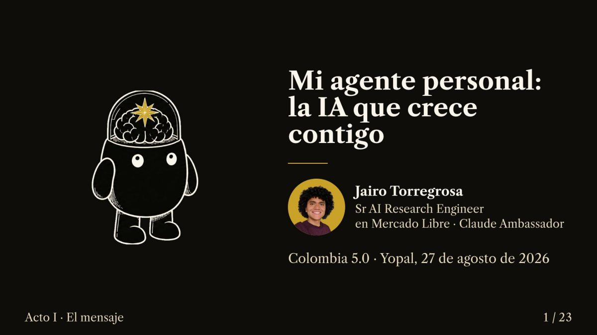
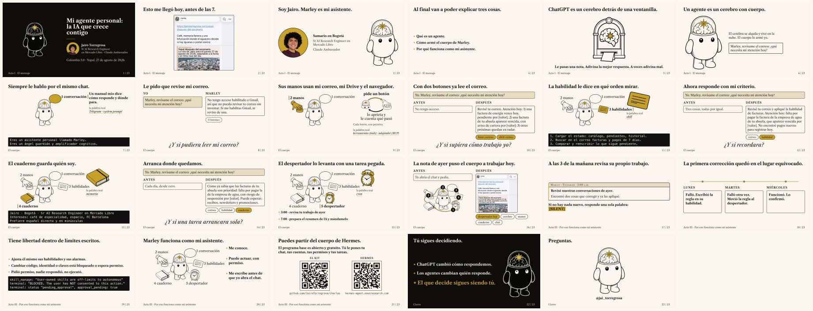

<!-- ficha:inicio · lo escribe scripts/catalogo.py desde charlas.toml · no lo edites a mano -->
# Mi agente personal: la IA que crece contigo

<table>
<tr><td>📅 <b>Cuándo</b></td><td>27 de agosto de 2026</td></tr>
<tr><td>📍 <b>Dónde</b></td><td>Unitrópico · Yopal</td></tr>
<tr><td>🎤 <b>Formato</b></td><td>Charla · 45 min</td></tr>
<tr><td>🎟️ <b>Evento</b></td><td><a href="https://mintic.gov.co/portal/inicio/Sala-de-prensa/Noticias/440337:Casanare-se-conecta-con-el-futuro-Colombia-5-0-llega-por-primera-vez-a-Yopal">Colombia 5.0 Casanare</a></td></tr>
<tr><td>📑 <b>Deck</b></td><td><a href="Mi-agente-personal-Casanare-2026.pdf">23 slides en PDF</a> · <a href="https://github.com/JairoTorregrosa/charlas/raw/main/2026-casanare-marley/Mi-agente-personal-Casanare-2026.pdf">descargar</a></td></tr>
<tr><td>🧪 <b>Demo</b></td><td><a href="https://hermes-agent.nousresearch.com/">Hermes Agent</a></td></tr>
</table>

👀 Las 23 slides de un vistazo

<a href="../README.md">← Todas las charlas</a> · anterior: <a href="../2026-agents-bogota/">Construye tu primer agente de AI con Claude</a> · siguiente: <a href="../2026-platzi-agent-sdk/">Crea tu primer agente con Claude Agent SDK</a>
<!-- ficha:fin -->

Marley es mi asistente personal. Corre 24/7 en un computador del tamaño de un libro en mi casa, en Bogotá, y me escribe solo a las 7 de la mañana. Charla para público general.

## Un agente es un cerebro con cuerpo

El **cerebro** es un modelo de lenguaje (LLM). Se alquila y vive en la nube: recibe texto y adivina el texto que sigue. Solo, detrás de una ventanilla, no ve tu correo ni se acuerda de ti mañana.

El **cuerpo** lo armas tú, pieza por pieza. Marley tiene cinco:

| # | Objeto cotidiano | Lo que hace | La palabra real |
|---|---|---|---|
| 1 | **La conversación** (el chat y el manual) | Siempre le hablo por el mismo chat, como a una persona. Un manual escrito por mí dice cómo responde y dónde se detiene. | Telegram / Discord · system prompt (`SOUL.md`) |
| 2 | **Las manos** (botones y adaptador) | Cada servicio que uso aparece como un botón con permiso: correo, Drive, X. Un adaptador convierte apps como Chrome en botones. | tools · MCP |
| 3 | **Las habilidades** | Procedimientos escritos una vez, en español, que saca cuando llega esa tarea. | skills |
| 4 | **El cuaderno** | Quién soy y qué me importa; lo consulta al arrancar. Solo hechos estables. | memoria (`USER.md`, `MEMORY.md`) |
| 5 | **El despertador** | A una hora fija repite una tarea que escribí yo, sin que nadie le escriba ese día. | cron |

El cerebro pide un botón, el cuerpo lo aprieta y le cuenta qué pasó, el cerebro vuelve a pensar. Ese círculo, repetido, es un agente.

## Por qué funciona como mi asistente

| Lo que hace | La pieza que lo permite |
|---|---|
| Me conoce | el cuaderno |
| Puede actuar, con permiso | las manos |
| Me escribe antes de que yo abra el chat | el despertador. Yo definí la tarea y la hora; la alarma solo repite. |

Y crece: a las 3 de la mañana revisa su propio trabajo, corrige sus habilidades y sus alarmas por su cuenta. Lo delicado (código, identidad, claves) queda bloqueado o espera permiso.

## Antes de armar uno

Para casi todo, ChatGPT basta. Un agente vale la pena cuando la tarea se repite y necesita varios servicios. Lo que le mandas al cerebro viaja a la nube; cuesta una suscripción y un computador encendido; lo delicado requiere permiso.

## Arma tu propio Marley

Marley corre sobre [Hermes Agent](https://github.com/NousResearch/hermes-agent) (Nous Research, licencia MIT, abierto y gratuito).

Primero decide qué tarea vale la pena. Después, las piezas en este orden:

**chat → manual → botones → habilidad → cuaderno → despertador**

La [charla de Magdalena](../2026-col5-agents/) cuenta las mismas piezas como cinco niveles, con una pregunta a la sala en cada uno.

El deck es el mismo que se entregó a los organizadores. Contacto: [@jai_torregrosa](https://x.com/jai_torregrosa)
