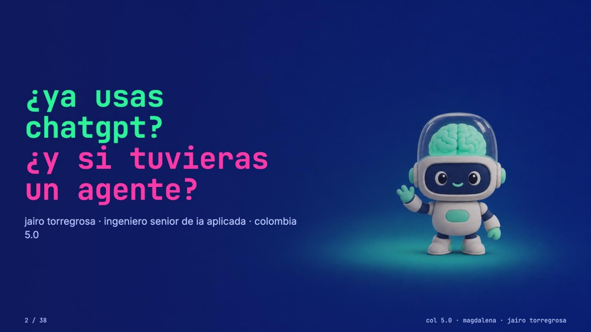
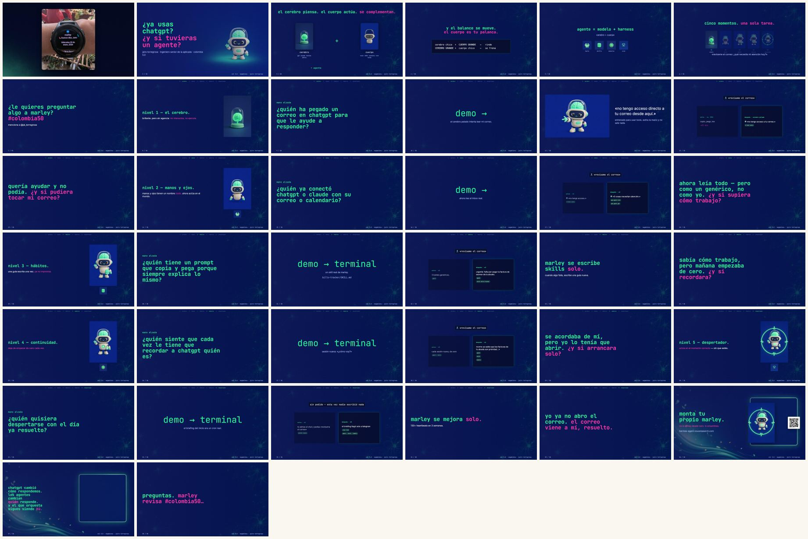

<!-- ficha:inicio · lo escribe scripts/catalogo.py desde charlas.toml · no lo edites a mano -->
# ¿Ya usas ChatGPT? ¿Y si tuvieras un agente?

<table>
<tr><td>📅 <b>Cuándo</b></td><td>Mayo de 2026</td></tr>
<tr><td>📍 <b>Dónde</b></td><td>Universidad Antonio Nariño · Santa Marta</td></tr>
<tr><td>🎤 <b>Formato</b></td><td>Charla</td></tr>
<tr><td>🎟️ <b>Evento</b></td><td><a href="https://canaltrece.com.co/noticias/colombia-5-0-magdalena-reunio-a-mas-de-1-150-asistentes-en-santa-marta/">Colombia 5.0 Magdalena</a></td></tr>
<tr><td>📑 <b>Deck</b></td><td><a href="Ya-usas-ChatGPT-y-si-tuvieras-un-agente-Colombia50-Magdalena-2026.pdf">38 slides en PDF</a> · <a href="https://github.com/JairoTorregrosa/charlas/raw/main/2026-col5-agents/Ya-usas-ChatGPT-y-si-tuvieras-un-agente-Colombia50-Magdalena-2026.pdf">descargar</a></td></tr>
<tr><td>🧪 <b>Demo</b></td><td><a href="https://hermes-agent.nousresearch.com/">Hermes Agent</a></td></tr>
</table>

👀 Las 38 slides de un vistazo

<a href="../README.md">← Todas las charlas</a> · siguiente: <a href="../2026-hapgj/">Crea tu Web con IA</a>
<!-- ficha:fin -->

Charla de Colombia 5.0 (Magdalena, 2026). La diferencia entre usar un chat y tener un agente: cerebro, manos, hábitos, memoria y despertador — las cinco piezas, con ejemplos de todos los días.

## Qué hay aquí

| Archivo | Qué es |
|---|---|
| [`Ya-usas-ChatGPT-y-si-tuvieras-un-agente-Colombia50-Magdalena-2026.pdf`](Ya-usas-ChatGPT-y-si-tuvieras-un-agente-Colombia50-Magdalena-2026.pdf) | El deck tal como se proyectó: 38 páginas, 16:9 |

Contacto: [@jai_torregrosa](https://x.com/jai_torregrosa)
