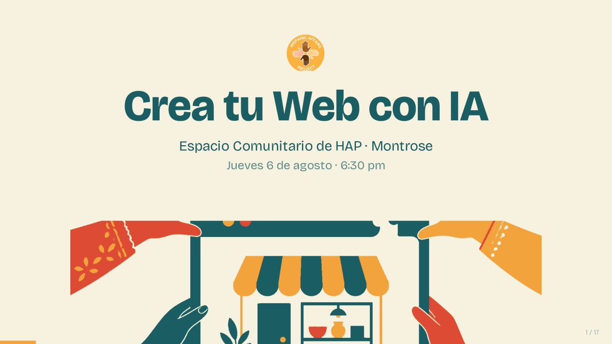
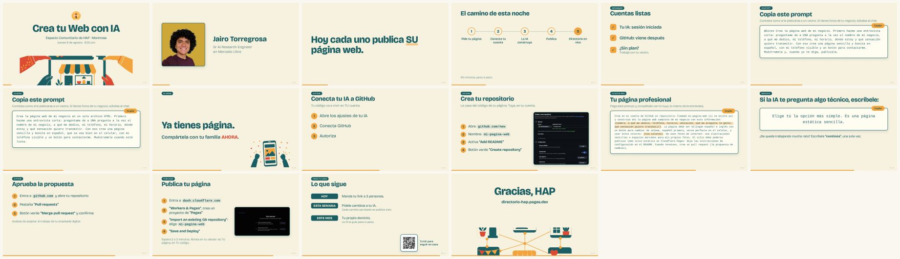

<!-- ficha:inicio · lo escribe scripts/catalogo.py desde charlas.toml · no lo edites a mano -->
# Crea tu Web con IA

<table>
<tr><td>📅 <b>Cuándo</b></td><td>6 de agosto de 2026</td></tr>
<tr><td>📍 <b>Dónde</b></td><td>Espacio Comunitario de HAP · Montrose, Colorado</td></tr>
<tr><td>🎤 <b>Formato</b></td><td>Taller · 90 min</td></tr>
<tr><td>🎟️ <b>Evento</b></td><td><a href="https://hapgj.org/">Hispanic Affairs Project</a></td></tr>
<tr><td>📑 <b>Deck</b></td><td><a href="Crea-tu-Web-con-IA-HAP-Montrose-2026.pdf">16 slides en PDF</a> · <a href="https://github.com/JairoTorregrosa/charlas/raw/main/2026-hapgj/Crea-tu-Web-con-IA-HAP-Montrose-2026.pdf">descargar</a></td></tr>
<tr><td>🛠️ <b>Skill</b></td><td><a href="https://github.com/JairoTorregrosa/crea-tu-web"><code>crea-tu-web</code></a></td></tr>
</table>

👀 Las 16 slides de un vistazo

<a href="../README.md">← Todas las charlas</a> · anterior: <a href="../2026-col5-agents/">¿Ya usas ChatGPT? ¿Y si tuvieras un agente?</a> · siguiente: <a href="../2026-agents-bogota/">Construye tu primer agente de AI con Claude</a>
<!-- ficha:fin -->

Taller en el Espacio Comunitario de HAP (Montrose, 6 de agosto de 2026). Levantar tu primera página web usando IA, sin escribir código.

## Qué hay aquí

| Archivo | Qué es |
|---|---|
| [`Crea-tu-Web-con-IA-HAP-Montrose-2026.pdf`](Crea-tu-Web-con-IA-HAP-Montrose-2026.pdf) | El deck tal como se proyectó: 17 páginas, 16:9 |

Contacto: [@jai_torregrosa](https://x.com/jai_torregrosa)
