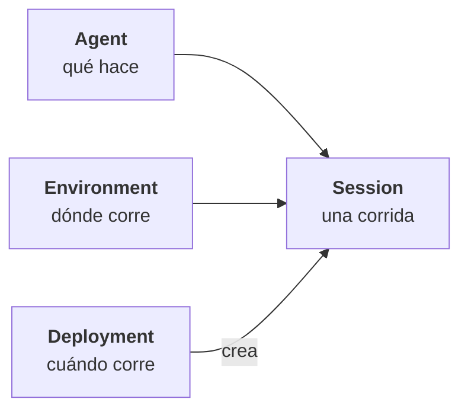

<!-- ficha:inicio · lo escribe scripts/catalogo.py desde charlas.toml · no lo edites a mano -->
# Agentes en la nube con Claude Managed Agents

<a href="Agentes-en-la-nube-Claude-Managed-Agents-LaSalle-2026.pdf"></a>

<table>
<tr><td>📅 <b>Cuándo</b></td><td>24 de octubre de 2026</td></tr>
<tr><td>📍 <b>Dónde</b></td><td>Universidad de La Salle · Bogotá</td></tr>
<tr><td>🎤 <b>Formato</b></td><td>Workshop · 3 h</td></tr>
<tr><td>🎟️ <b>Evento</b></td><td><a href="https://luma.com/claude-wbvh">Claude Community Bogotá</a> · Luma</td></tr>
<tr><td>📑 <b>Deck</b></td><td><a href="Agentes-en-la-nube-Claude-Managed-Agents-LaSalle-2026.pdf">30 slides en PDF</a> · <a href="https://github.com/JairoTorregrosa/charlas/raw/main/2026-lasalle-managed-agents/Agentes-en-la-nube-Claude-Managed-Agents-LaSalle-2026.pdf">descargar</a></td></tr>
<tr><td>🧪 <b>Demo</b></td><td><a href="../2026-bogota-agent-sdk/managed-agents">el mismo agente en código (kit de septiembre)</a></td></tr>
<tr><td>🛠️ <b>Skill</b></td><td><a href="https://github.com/JairoTorregrosa/jaiskills/tree/main/skills/models/managed-agents-wizard"><code>managed-agents-wizard</code></a></td></tr>
</table>

<details>
<summary>👀 Las 30 slides de un vistazo</summary>

<a href="Agentes-en-la-nube-Claude-Managed-Agents-LaSalle-2026.pdf"></a>

</details>

<sub><a href="../README.md">← Todas las charlas</a> · anterior: <a href="../2026-bogota-agent-sdk/">Crea tu primer agente con la Claude Agent SDK</a> · siguiente: <a href="../2026-javeriana-agent-sdk/">Crea tu primer agente con la Claude Agent SDK</a></sub>
<!-- ficha:fin -->

Un caso de uso que ya corre en Claude Code, en el portátil, pasa a un agente remoto que no depende de nadie ni de un PC prendido. Workshop con la Maestría en Analítica e Inteligencia de Negocios de La Salle.

## Del portátil a la nube

| Hoy, en Claude Code | Remoto, en Managed Agents |
|---|---|
| portátil prendido | **Environment** · contenedor en la nube |
| `CLAUDE.md` y skills | **Agent** · system prompt y skills |
| prompt escrito a mano | **Deployment** · cron o backend propio |
| tokens en un `.env` | **vault** · el sandbox no los ve |
| aprobación manual | **permisos** · `always_ask` + código propio |
| conversación en la terminal | **Session** · log en el servidor |

## Cuatro piezas: el agente se define una vez y corre mil veces



Los **events** son lo que entra y sale de la Session: tú mandas `user.*` y la Session cuenta el resto.

## Arma el tuyo: `managed-agents-wizard`

Lo único que hace falta es la skill, en Claude Code:

```
npx skills add JairoTorregrosa/jaiskills --skill managed-agents-wizard -g
claude
> /managed-agents-wizard
```

| Paso | Qué haces | Con qué |
|---|---|---|
| 1 · Diseña | De una idea a Agent, Environment, credenciales y forma de arranque | Claude Code + wizard |
| 2 · Prueba | Una Session de prueba, con budget | CLI `ant` |
| 3 · Itera | Lees las trazas y ajustas | [platform.claude.com](https://platform.claude.com) › Sessions |
| 4 · Programa | El agente corre con horario | Deployment |

¿Prefieres leerlo en código? El asistente de viaje del workshop de septiembre tiene su versión en Managed Agents: [`managed-agents/`](../2026-bogota-agent-sdk/managed-agents/).

## Comunidad

Claude Colombia: [claudecolombia.com](https://claudecolombia.com) · [comunidad de WhatsApp](https://chat.whatsapp.com/BVelw8cvSMEFKq9wjkY2a9)
