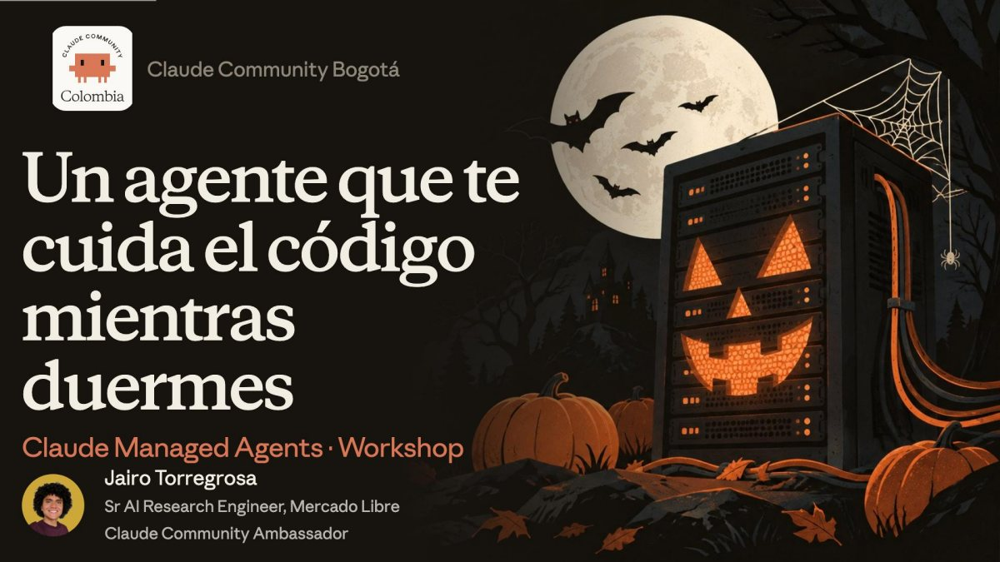
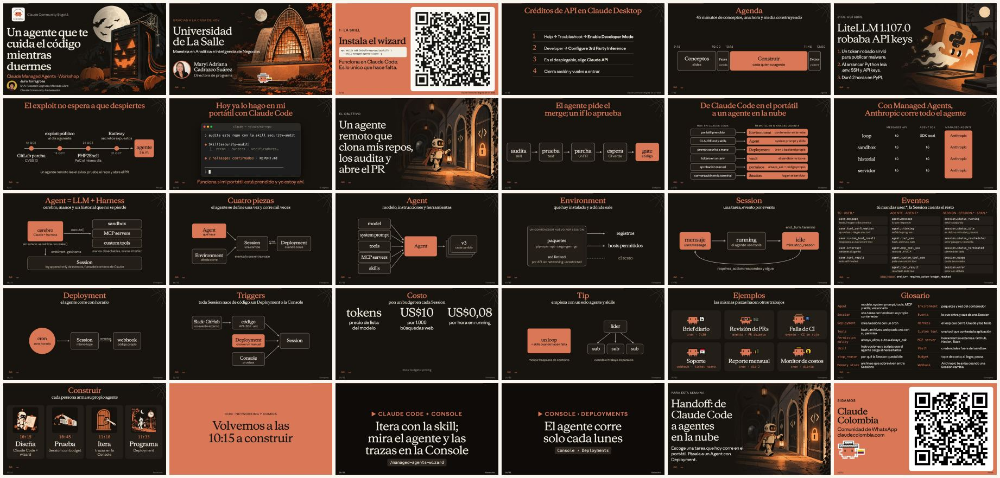

<!-- ficha:inicio · lo escribe scripts/catalogo.py desde charlas.toml · no lo edites a mano -->
# Agentes en la nube con Claude Managed Agents

<a href="Agentes-en-la-nube-Claude-Managed-Agents-LaSalle-2026.pdf"></a>

<table>
<tr><td>📅 <b>Cuándo</b></td><td>24 de octubre de 2026</td></tr>
<tr><td>📍 <b>Dónde</b></td><td>Universidad de La Salle · Bogotá</td></tr>
<tr><td>🎤 <b>Formato</b></td><td>Workshop · 3 h</td></tr>
<tr><td>🎟️ <b>Evento</b></td><td><a href="https://luma.com/claude-wbvh">Claude Community Bogotá</a> · Luma</td></tr>
<tr><td>📑 <b>Deck</b></td><td><a href="Agentes-en-la-nube-Claude-Managed-Agents-LaSalle-2026.pdf">30 slides en PDF</a> · <a href="https://github.com/JairoTorregrosa/charlas/raw/main/2026-lasalle-managed-agents/Agentes-en-la-nube-Claude-Managed-Agents-LaSalle-2026.pdf">descargar</a></td></tr>
<tr><td>🧪 <b>Demo</b></td><td><a href="../2026-bogota-agent-sdk/managed-agents">el mismo agente en código (kit de septiembre)</a></td></tr>
<tr><td>🛠️ <b>Skill</b></td><td><a href="https://github.com/JairoTorregrosa/jaiskills/tree/main/skills/models/managed-agents-wizard"><code>managed-agents-wizard</code></a></td></tr>
</table>

<details>
<summary>👀 Las 30 slides de un vistazo</summary>

<a href="Agentes-en-la-nube-Claude-Managed-Agents-LaSalle-2026.pdf"></a>

</details>

<sub><a href="../README.md">← Todas las charlas</a> · anterior: <a href="../2026-bogota-agent-sdk/">Crea tu primer agente con la Claude Agent SDK</a> · siguiente: <a href="../2026-javeriana-agent-sdk/">Crea tu primer agente con la Claude Agent SDK</a></sub>
<!-- ficha:fin -->

Workshop de Claude Community Bogotá en la Universidad de La Salle (Maestría en Analítica e Inteligencia de Negocios), sábado 24 de octubre de 2026.
Ponente: Jairo Torregrosa.

Cómo pasar un caso de uso que ya corre en Claude Code, en el portátil, a un agente remoto que no depende de nadie ni de un PC prendido: Agent, Environment, Session, eventos y Deployment.

## Construye tu propio agente

Lo único que hace falta es la skill `managed-agents-wizard` en Claude Code:

```
npx skills add JairoTorregrosa/jaiskills --skill managed-agents-wizard -g
claude
> /managed-agents-wizard
```

La skill parte de una idea, propone Agent, Environment, credenciales y forma de arranque, aplica con el CLI `ant` y corre una Session de prueba con budget. Las trazas se ven en [platform.claude.com](https://platform.claude.com) › Sessions.

## Comunidad

Claude Colombia: [claudecolombia.com](https://claudecolombia.com) · [comunidad de WhatsApp](https://chat.whatsapp.com/BVelw8cvSMEFKq9wjkY2a9)
