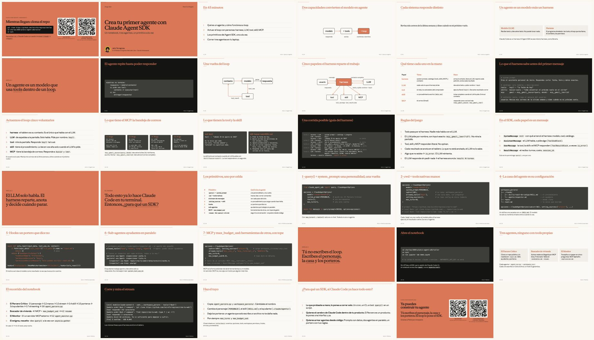

<!-- ficha:inicio · lo escribe scripts/catalogo.py desde charlas.toml · no lo edites a mano -->
# Crea tu primer agente con Claude Agent SDK

<a href="Crea-tu-primer-agente-Agent-SDK-Platzi-2026.pdf"></a>

<table>
<tr><td>📅 <b>Cuándo</b></td><td>29 de agosto de 2026</td></tr>
<tr><td>📍 <b>Dónde</b></td><td>Ágora Bogotá</td></tr>
<tr><td>🎤 <b>Formato</b></td><td>Taller · 45 min</td></tr>
<tr><td>🎟️ <b>Evento</b></td><td><a href="https://platzi.com/conf/">Platzi Conf Bogotá 2026</a></td></tr>
<tr><td>📑 <b>Deck</b></td><td><a href="Crea-tu-primer-agente-Agent-SDK-Platzi-2026.pdf">35 slides en PDF</a> · <a href="https://github.com/JairoTorregrosa/charlas/raw/main/2026-platzi-agent-sdk/Crea-tu-primer-agente-Agent-SDK-Platzi-2026.pdf">descargar</a></td></tr>
<tr><td>🧪 <b>Demo</b></td><td><a href="demo.ipynb">demo.ipynb</a></td></tr>
<tr><td>🛠️ <b>Skill</b></td><td><a href=".claude/skills/setup-taller"><code>setup-taller</code></a> · <a href=".claude/skills/crear-agente"><code>crear-agente</code></a></td></tr>
</table>

<details>
<summary>👀 Las 35 slides de un vistazo</summary>

<a href="Crea-tu-primer-agente-Agent-SDK-Platzi-2026.pdf"></a>

</details>

<sub><a href="../README.md">← Todas las charlas</a> · anterior: <a href="../2026-casanare-marley/">Mi agente personal: la IA que crece contigo</a> · siguiente: <a href="../2026-bogota-agent-sdk/">Crea tu primer agente con la Claude Agent SDK</a></sub>
<!-- ficha:fin -->

Un notebook, tres agentes y un primitivo de la SDK por celda. Los agentes usan lo que trae el SDK (Read, Bash, WebFetch…), un skill, un ayudante y servidores MCP externos. Ninguno tiene tools propias. Cada uno escribe un solo archivo en su casa; un hook lo garantiza.

## El recorrido: un primitivo por celda

| # | Primitivo | Qué le da al agente |
|---|---|---|
| 1 | `query()` + `system_prompt` | una personalidad y una vuelta |
| 2 | `cwd` + tools nativas | manos: leer, correr comandos |
| 3 | el stream de mensajes | ver cada paso del ciclo |
| 4 | `setting_sources` + skill | un procedimiento que carga cuando hace falta |
| 5 | hooks | un portero que dice no |
| 6 | sub-agentes | ayudantes que trabajan en paralelo |
| 7 | MCP + `max_budget_usd` | herramientas de otros, con tope de gasto |
| 8 | `resume` · dos `query()` a la vez | seguir la conversación · orquestar desde código |

Todo el hilo está en [`demo.ipynb`](demo.ipynb).

## Tres agentes, ninguno con tools propias

| Agente | Archivo | Su casa | Qué hace |
|---|---|---|---|
| El Parcero Crítico | `agent_parcero.py` | `workspace_parcero/` | Clona un repo público de GitHub y lo roastea en `roast.md`. |
| Buscador de vivienda | `agent_vivienda.py` | `workspace_vivienda/` | Busca avisos reales de arriendo en Bogotá (Exa y Firecrawl por MCP) y deja una tabla en `candidatos.md`. |
| El Monitor | `agent_monitor.py` | `workspace_monitor/` | Te explica un paper en cinco preguntas (alphaXiv por MCP), en `explicacion.md`. |

## Córrelo

```bash
git clone https://github.com/JairoTorregrosa/charlas.git
cd charlas/2026-platzi-agent-sdk
uv sync
uv run jupyter lab demo.ipynb
```

> El deck dice `cd charlas/2026-platzi-agent-sdk/taller` y `taller/docs/`. Esa carpeta no existe: el kit vive en la raíz de `2026-platzi-agent-sdk/`.

Cada agente también corre solo, desde la terminal:

```bash
uv run agent_parcero.py https://github.com/JairoTorregrosa/crea-tu-web
uv run agent_vivienda.py "Apartamento en Chapinero, máximo 2.500.000, 2 habitaciones"
uv run agent_monitor.py "Attention is all you need"
```

Lo que gasta es la cuota de tu plan (límite de sesión y semanal), no dinero. El `total_cost_usd` del recibo es un estimado del SDK, útil para comparar corridas. Sin suscripción, ver [Otros cerebros](#otros-cerebros).

<details>
<summary>Paso a paso con tu suscripción de Claude</summary>

El SDK no trae el modelo: arranca Claude Code como subproceso y usa la sesión que tengas iniciada ahí. Con una cuenta Pro o Max no necesitas API key.

1. Instala [uv](https://docs.astral.sh/uv/) (trae Python 3.13 si te falta) y `git`.
2. Instala Claude Code: `npm install -g @anthropic-ai/claude-code`.
3. Inicia sesión una vez: `claude` → `/login`. Es el login de Claude Code, no el del navegador.
4. Revisa que no haya una API key en el entorno: `echo $ANTHROPIC_API_KEY` debe salir vacío. Si sale algo, `unset ANTHROPIC_API_KEY` en esa terminal (una key gana sobre la suscripción y cobra por token).
5. Clona y corre:
   ```bash
   git clone https://github.com/JairoTorregrosa/charlas.git
   cd charlas/2026-platzi-agent-sdk
   uv sync
   uv run jupyter lab demo.ipynb
   ```
6. Ejecuta las celdas en orden. La sección 0 comprueba que `claude` responde y que no hay `ANTHROPIC_API_KEY`; la celda `PROVEEDOR = "claude"` elige el cerebro de todo el notebook.

En VS Code: abre la carpeta, elige el intérprete `.venv/bin/python` (ya viene en `.vscode/settings.json`) y corre las celdas desde ahí.

</details>

<details>
<summary>El Monitor necesita alphaXiv</summary>

Es un servidor MCP con OAuth. Se registra una vez en tu Claude Code y se autentica en el navegador:

```bash
claude mcp add --transport http alphaxiv https://api.alphaxiv.org/mcp/v1 --scope user
claude     # → /mcp → alphaxiv → Authenticate
```

Los otros dos MCP del taller (Exa y Firecrawl, en `workspace_vivienda/.mcp.json`) no piden llave.

</details>

## Otros cerebros

El SDK habla la API de Anthropic; cualquier servicio que hable ese formato sirve. Claude Code sigue siendo el subproceso (pasos 1, 2 y 5 de arriba), pero sin `/login`: la llave del proveedor va en variables de entorno que `proveedores.py` arma y el notebook aplica en una celda:

```python
PROVEEDOR = "openrouter"   # "claude" · "openrouter" · "opencode" · "codex"
```

| `PROVEEDOR` | Qué es | Costo | Qué hace falta |
|---|---|---|---|
| `"claude"` | Suscripción de Claude Code | suscripción | `claude` → `/login` |
| `"openrouter"` | OpenRouter, modelo `minimax/minimax-m3:free` | 0 | `OPENROUTER_API_KEY` en `.env` |
| `"opencode"` | OpenCode Zen, modelo `big-pickle` (sin verificar) | 0 | `OPENCODE_API_KEY` en `.env` |
| `"codex"` | Suscripción de ChatGPT, vía LiteLLM, modelo `gpt-5.6-luna` | suscripción | Proxy local: `litellm/start.sh` |

Dos límites: los conectores MCP de claude.ai (y con ellos El Monitor) van solo con `"claude"`, y la tool nativa `WebSearch` es la búsqueda del servidor de Anthropic; por eso el Buscador de vivienda busca por MCP. Con estos proveedores cada celda imprime dos avisos en `stderr` (`connectors are disabled`, `unrecognized_model`); son avisos, no errores. El detalle de cada uno, con un `curl` para probar antes de abrir el notebook, está en [`docs/proveedores.md`](docs/proveedores.md).

<details>
<summary>OpenRouter (gratis)</summary>

1. Crea una llave en https://openrouter.ai/settings/keys. Ponle límite de crédito; los modelos `:free` cuestan 0.
2. `cp .env.example .env` y pon `OPENROUTER_API_KEY=sk-or-v1-...`.
3. En el notebook, `PROVEEDOR = "openrouter"`. Otro modelo gratis: `proveedor("openrouter", "z-ai/glm-5.2:free")`.

</details>

<details>
<summary>OpenCode Zen (gratis)</summary>

1. Entra a https://opencode.ai/auth con GitHub o Google y copia la API key.
2. En `.env`, `OPENCODE_API_KEY=...`.
3. `PROVEEDOR = "opencode"`. Si el `curl` de `docs/proveedores.md` devuelve 401, el header es `x-api-key`; el cambio en `proveedores.py` está indicado ahí.

</details>

<details>
<summary>Suscripción de ChatGPT (Codex) vía LiteLLM</summary>

El backend de Codex habla Responses API; LiteLLM lo traduce al formato de Anthropic y usa el login OAuth de Codex.

1. `uv tool install "litellm[proxy]==1.98.0"` (evita 1.82.7 y 1.82.8, que salieron con malware).
2. Arranca el proxy: `litellm/start.sh` (puerto 4000). Déjalo corriendo en su terminal.
3. Primera petición: en el log del proxy sale `Visit https://auth0.openai.com/codex/device` con un código. Entras, pegas el código, y LiteLLM guarda los tokens en `~/.config/litellm/chatgpt/auth.json`.
4. `PROVEEDOR = "codex"`. Modelos: `gpt-5.6-luna` (default), `gpt-5.6-sol`, `gpt-5.6-terra`, los tres con razonamiento `high`.

`litellm/fix_system.py` es un hook del proxy: el backend de ChatGPT rechaza los mensajes con `role: system`, y el hook los mueve al `system` antes de enviar.

</details>

## Cómo está armado

```
2026-platzi-agent-sdk/
├── demo.ipynb              ← el notebook: el hilo completo, un primitivo por celda
├── agent_parcero.py        ← un agente = un archivo
├── agent_vivienda.py
├── agent_monitor.py
├── proveedores.py          ← el cerebro: qué modelo y qué variables de entorno
├── workspace_parcero/      ← la casa del agente: lo que ve como cwd
│   └── .claude/
│       ├── skills/roast-de-codigo/SKILL.md     ← el procedimiento
│       └── agents/inspector.md                 ← el ayudante
├── workspace_vivienda/     ← misma forma, más .mcp.json (Exa, Firecrawl)
├── workspace_monitor/      ← misma forma
├── litellm/                ← proxy para la suscripción de ChatGPT
├── .claude/skills/         ← setup-taller y crear-agente, para tu agente de código
└── docs/                   ← cheat sheets
```

- El `.py` tiene el system prompt, las opciones del SDK, los porteros (hooks) y el lector del stream.
- La carpeta `workspace_` tiene lo que una persona puede editar sin programar: el skill, el ayudante y los MCP. El agente la carga con `setting_sources=["project"]`.

## Cuánto cuesta una corrida

Medido con `claude-sonnet-5`:

| Agente | Costo | Tiempo |
|---|---|---|
| El Parcero Crítico | ≈ USD 0.31 | 108 s |
| Buscador de vivienda | ≈ USD 0.70 | 91 s |
| El Monitor | ≈ USD 0.36 | 75 s |
| El notebook completo | ≈ USD 3.5 | |

Todos los agentes tienen `max_budget_usd` como tope; con una suscripción el costo es el estimado del SDK, no un cobro.

## Dos skills para tu agente de código

Abre Claude Code (o Codex) en esta carpeta y tienes dos skills:

- `/setup-taller`: deja el notebook corriendo en tu máquina. Revisa uv, git, Node, Claude Code, el login, las variables `ANTHROPIC_*`, el SDK, la llave del proveedor, los MCP (Exa, Firecrawl, alphaXiv) y hace una llamada real al modelo; arregla lo que sea un comando y te pide lo que sea un login o una llave. Con `--notebook` ejecuta la sección 0 y la celda 3.1. El chequeo también corre solo: `uv run python .claude/skills/setup-taller/scripts/check.py --proveedor claude`.
- `/crear-agente`: arma un agente nuevo en la forma del taller (`agent_<nombre>.py` + `workspace_<nombre>/`) preguntando un primitivo a la vez: qué hace, personaje, manos, skill, ayudante, MCP, tope y cerebro. Lo escribe desde plantillas y lo corre una vez antes de decir que está listo.

Viven en `.claude/skills/` (`.agents/skills` apunta ahí para Codex).

## Cheat sheets

| Hoja | Cuándo abrirla |
|---|---|
| [`event_model.md`](docs/event_model.md) | «¿Qué me está llegando en el `async for`?» |
| [`options.md`](docs/options.md) | «¿Cómo se llama esa opción y qué default tiene?» |
| [`tools.md`](docs/tools.md) | «¿Qué campo tiene el input de `Read`?» |
| [`workspace.md`](docs/workspace.md) | «¿Dónde pongo el skill, el ayudante o el MCP?» |
| [`permisos_hooks.md`](docs/permisos_hooks.md) | «¿Por qué corrió (o no) esa tool?» |
| [`errores.md`](docs/errores.md) | «Se rompió.» Síntoma → causa → arreglo. |
| [`proveedores.md`](docs/proveedores.md) | «¿Y si no tengo suscripción de Claude?» |

## Haz el tuyo

Copia un `agent_x.py` y su `workspace_x/`. Cambia el system prompt, el skill y el ayudante. Deja los porteros y los topes.

Verificado con `claude-agent-sdk` 0.2.148 y Claude Code 2.1.251 (2026-08-29). El material se comparte tal cual, para aprender y reutilizar con atribución.
