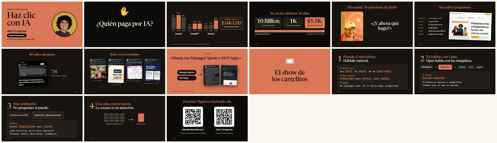

<!-- ficha:inicio · lo escribe scripts/catalogo.py desde charlas.toml · no lo edites a mano -->
# Haz clic con IA

<table>
<tr><td>📅 <b>Cuándo</b></td><td>26 de noviembre de 2026</td></tr>
<tr><td>📍 <b>Dónde</b></td><td>Innovalab CCB · Bogotá</td></tr>
<tr><td>🎤 <b>Formato</b></td><td>Workshop · 30 min</td></tr>
<tr><td>🎟️ <b>Evento</b></td><td><a href="https://www.ccb.org.co/servicios/haz-crecer-tu-empresa/innovacion-empresarial/aceleradora-innovalab">Startup House Bogotá · Starter, 2600 e Innovalab CCB</a></td></tr>
<tr><td>📑 <b>Deck</b></td><td><a href="Haz-clic-con-IA-Startup-House-Bogota-2026.pdf">15 slides en PDF</a> · <a href="https://github.com/JairoTorregrosa/charlas/raw/main/2026-startup-house-haz-clic/Haz-clic-con-IA-Startup-House-Bogota-2026.pdf">descargar</a></td></tr>
<tr><td>🧪 <b>Demo</b></td><td><a href="prompts.md">Los 4 prompts</a></td></tr>
</table>

👀 Las 15 slides de un vistazo

<a href="../README.md">← Todas las charlas</a> · anterior: <a href="../2026-javeriana-agent-sdk/">Crea tu primer agente con la Claude Agent SDK</a>
<!-- ficha:fin -->

La IA buena cuesta US$100 o US$200 al mes y regala mucho más. Mi mamá, profe de matemáticas pensionada, hizo el clic. Cuatro prompts para que tú también lo hagas.

| Parte | Slides | Qué pasa |
|---|---|---|
| 💸 El subsidio | 1–4 | ✋ ¿Quién paga por IA? · cuánto regala cada plan · mi consumo en 30 días |
| 👩‍🏫 Mi mamá | 5–9 | De «¿y ahora qué hago?» a programar, publicar y dar charlas |
| 🪧 Cartelitos | 10 | El show con el público |
| 🛠️ 4 tips | 11–14 | [Prompts para copiar](prompts.md) |
| 📱 Cierre | 15 | QR a claudecolombia.com y a mi LinkedIn |

📝 [Guion](guion.md): las notas de orador, slide por slide.

**Fuentes de la gráfica del subsidio:** [@theo](https://x.com/theo) (barras, 23 nov 2026) y [@AdamHoltererer](https://x.com/AdamHoltererer) (US$14.662 al mes con solo Opus 5.5).
