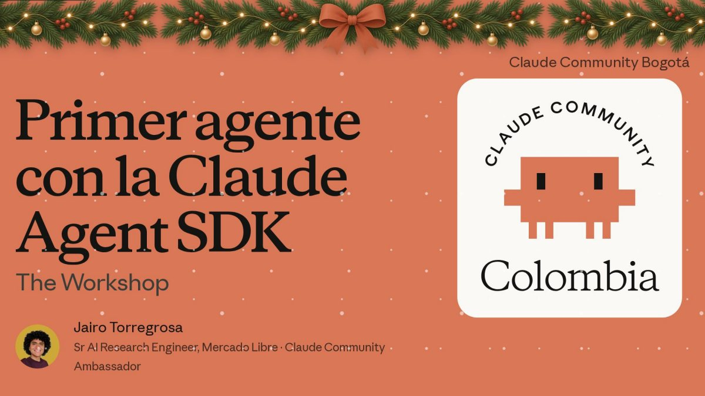
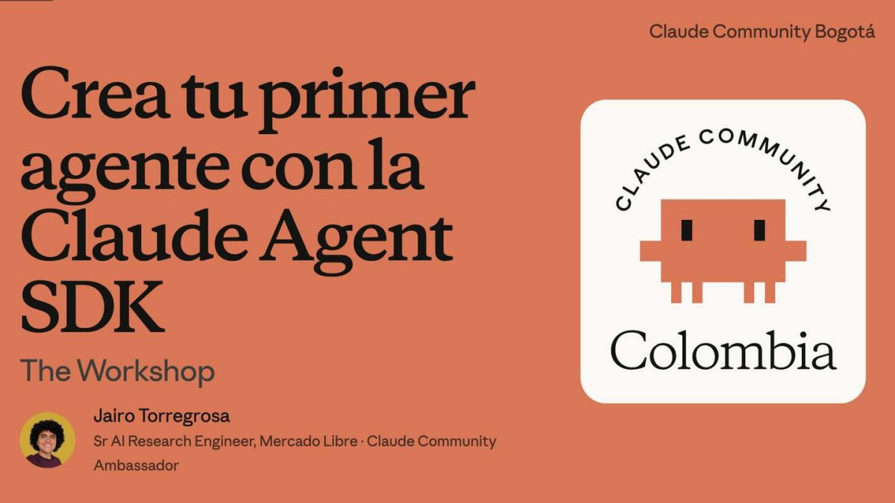
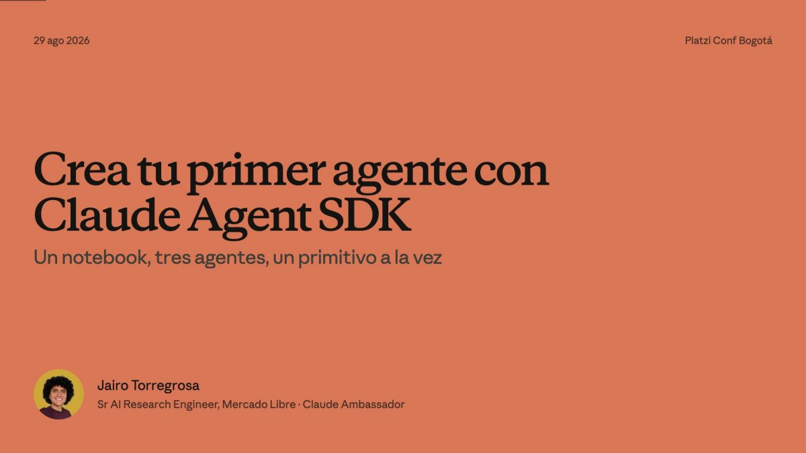
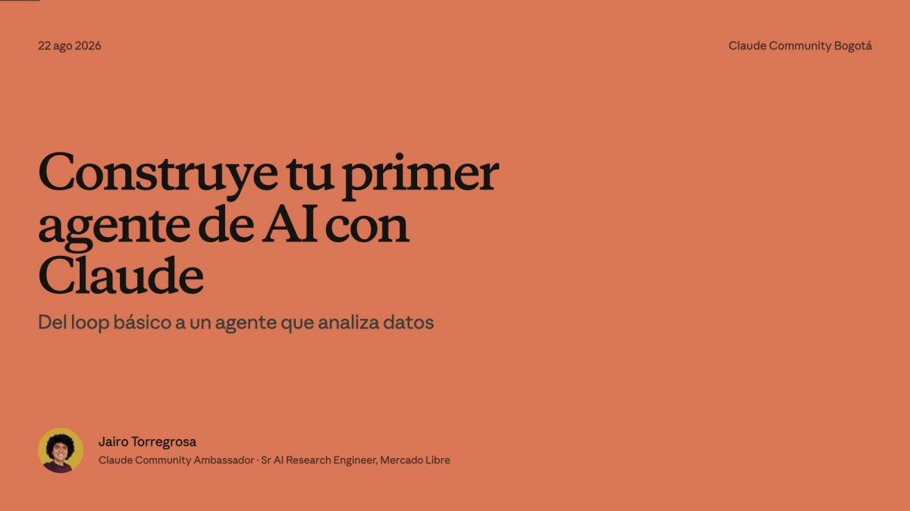
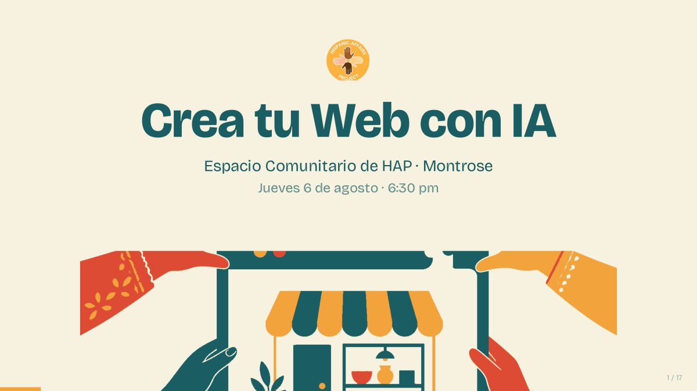
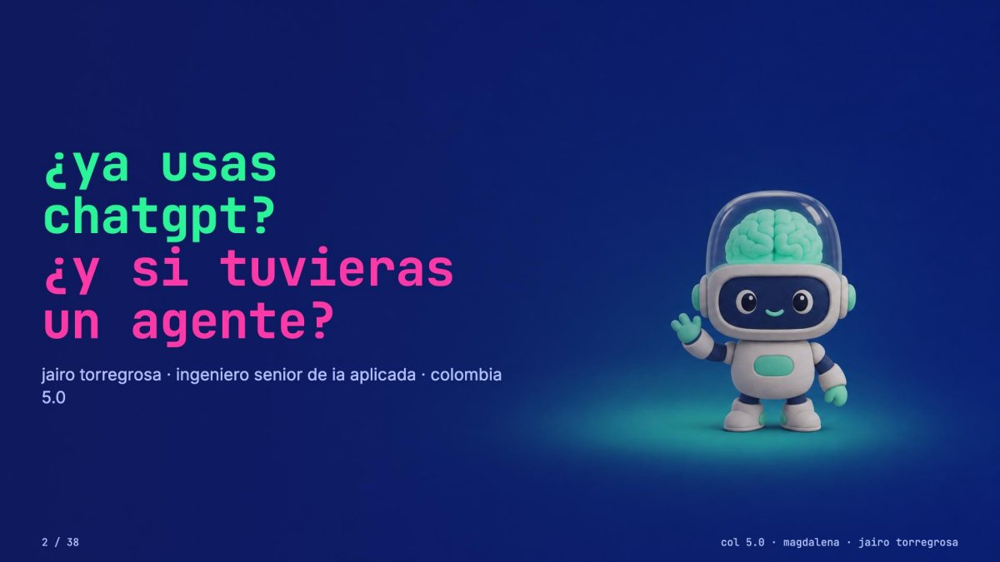

<p align="center">
  
</p>

<h1 align="center">Charlas — Jairo Torregrosa</h1>

<p align="center">
  <em>Ex profundis ad astra</em> — desde las profundidades, a las estrellas.
</p>

<p align="center">
  Esta es mi carta celeste. Cada charla es una constelación: el deck tal como se proyectó,<br>
  la demo para correrla y la skill para repetirla con tu propio agente.
</p>

<p align="center">
  <b>¿Vienes de un workshop?</b> Tu kit es una de estas tarjetas; la más reciente va primero.
</p>

<!-- indice:inicio · lo escribe scripts/catalogo.py desde charlas.toml · no lo edites a mano -->
<p align="center"><b>8</b> charlas · <b>265</b> slides · <b>4</b> ciudades · <b>6</b> skills</p>

## Constelaciones

<table>
<tr>
<td width="38%"><a href="2026-javeriana-agent-sdk/"></a></td>
<td valign="top">
<b><a href="2026-javeriana-agent-sdk/">Crea tu primer agente con la Claude Agent SDK</a></b><br>
<sub>7 nov 2026 · Pontificia Universidad Javeriana · Bogotá · Workshop · 3,5 h</sub><br>
Segunda edición: el asistente de viaje en diez piezas, hasta la salida estructurada.<br>
<a href="2026-javeriana-agent-sdk/Crea-tu-primer-agente-Agent-SDK-Javeriana-2026.pdf">📑 Deck</a> · <a href="2026-javeriana-agent-sdk/python">🧪 Demo</a> · <a href="2026-javeriana-agent-sdk/.claude/skills/agent-sdk-wizard">🛠️ Skill</a> · <a href="https://luma.com/claude-x1bt">🎟️ Luma</a>
</td>
</tr>
<tr>
<td width="38%"><a href="2026-lasalle-managed-agents/"></a></td>
<td valign="top">
<b><a href="2026-lasalle-managed-agents/">Agentes en la nube con Claude Managed Agents</a></b><br>
<sub>24 oct 2026 · Universidad de La Salle · Bogotá · Workshop · 3 h</sub><br>
De Claude Code en el portátil a un agente remoto: Agent, Environment, Session, eventos y Deployment.<br>
<a href="2026-lasalle-managed-agents/Agentes-en-la-nube-Claude-Managed-Agents-LaSalle-2026.pdf">📑 Deck</a> · <a href="2026-bogota-agent-sdk/managed-agents">🧪 Demo</a> · <a href="https://github.com/JairoTorregrosa/jaiskills/tree/main/skills/models/managed-agents-wizard">🛠️ Skill</a> · <a href="https://luma.com/claude-wbvh">🎟️ Luma</a>
</td>
</tr>
<tr>
<td width="38%"><a href="2026-bogota-agent-sdk/"></a></td>
<td valign="top">
<b><a href="2026-bogota-agent-sdk/">Crea tu primer agente con la Claude Agent SDK</a></b><br>
<sub>19 sep 2026 · Universidad Santo Tomás · Bogotá · Workshop · 3,5 h</sub><br>
Un asistente de viaje armado pieza por pieza: nueve primitivos, en Python y TypeScript.<br>
<a href="2026-bogota-agent-sdk/Crea-tu-primer-agente-Agent-SDK-Bogota-2026.pdf">📑 Deck</a> · <a href="2026-bogota-agent-sdk/python">🧪 Demo</a> · <a href="2026-bogota-agent-sdk/.claude/skills/crear-agente-sdk">🛠️ Skill</a> · <a href="https://luma.com/claude-be23">🎟️ Luma</a>
</td>
</tr>
<tr>
<td width="38%"><a href="2026-platzi-agent-sdk/"></a></td>
<td valign="top">
<b><a href="2026-platzi-agent-sdk/">Crea tu primer agente con Claude Agent SDK</a></b><br>
<sub>29 ago 2026 · Ágora Bogotá · Taller · 45 min</sub><br>
Un notebook, tres agentes y un primitivo de la SDK por celda.<br>
<a href="2026-platzi-agent-sdk/Crea-tu-primer-agente-Agent-SDK-Platzi-2026.pdf">📑 Deck</a> · <a href="2026-platzi-agent-sdk/demo.ipynb">🧪 Demo</a> · <a href="2026-platzi-agent-sdk/.claude/skills/setup-taller">🛠️ Skill</a> · <a href="https://platzi.com/conf/">🎟️ Evento</a>
</td>
</tr>
<tr>
<td width="38%"><a href="2026-casanare-marley/"></a></td>
<td valign="top">
<b><a href="2026-casanare-marley/">Mi agente personal: la IA que crece contigo</a></b><br>
<sub>27 ago 2026 · Unitrópico · Yopal · Charla · 45 min</sub><br>
Marley, mi asistente 24/7: un cerebro alquilado y un cuerpo de cinco piezas.<br>
<a href="2026-casanare-marley/Mi-agente-personal-Casanare-2026.pdf">📑 Deck</a> · <a href="https://hermes-agent.nousresearch.com/">🧪 Demo</a> · <a href="https://mintic.gov.co/portal/inicio/Sala-de-prensa/Noticias/440337:Casanare-se-conecta-con-el-futuro-Colombia-5-0-llega-por-primera-vez-a-Yopal">🎟️ Evento</a>
</td>
</tr>
<tr>
<td width="38%"><a href="2026-agents-bogota/"></a></td>
<td valign="top">
<b><a href="2026-agents-bogota/">Construye tu primer agente de AI con Claude</a></b><br>
<sub>22 ago 2026 · Oficinas de Quick · Bogotá · Charla · 1 h</sub><br>
Qué es un agente, cómo piensa por dentro y sus tres palancas: system prompt, tools y skills.<br>
<a href="2026-agents-bogota/Construye-tu-primer-agente-Bogota-2026.pdf">📑 Deck</a> · <a href="2026-agents-bogota/demo">🧪 Demo</a> · <a href="https://luma.com/claude-imxl">🎟️ Luma</a>
</td>
</tr>
<tr>
<td width="38%"><a href="2026-hapgj/"></a></td>
<td valign="top">
<b><a href="2026-hapgj/">Crea tu Web con IA</a></b><br>
<sub>6 ago 2026 · Espacio Comunitario de HAP · Montrose, Colorado · Taller · 90 min</sub><br>
Tu primera página web con IA, sin escribir código.<br>
<a href="2026-hapgj/Crea-tu-Web-con-IA-HAP-Montrose-2026.pdf">📑 Deck</a> · <a href="https://github.com/JairoTorregrosa/crea-tu-web">🛠️ Skill</a> · <a href="https://hapgj.org/">🎟️ Evento</a>
</td>
</tr>
<tr>
<td width="38%"><a href="2026-col5-agents/"></a></td>
<td valign="top">
<b><a href="2026-col5-agents/">¿Ya usas ChatGPT? ¿Y si tuvieras un agente?</a></b><br>
<sub>may 2026 · Universidad Antonio Nariño · Santa Marta · Charla</sub><br>
La diferencia entre un chat y un agente, en cinco piezas: cerebro, manos, hábitos, memoria y despertador.<br>
<a href="2026-col5-agents/Ya-usas-ChatGPT-y-si-tuvieras-un-agente-Colombia50-Magdalena-2026.pdf">📑 Deck</a> · <a href="https://hermes-agent.nousresearch.com/">🧪 Demo</a> · <a href="https://canaltrece.com.co/noticias/colombia-5-0-magdalena-reunio-a-mas-de-1-150-asistentes-en-santa-marta/">🎟️ Evento</a>
</td>
</tr>
</table>

## Bitácora

| # | Cuándo | Charla | Evento | Dónde | Formato |
|--:|---|---|---|---|---|
| 1 | may 2026 | [¿Ya usas ChatGPT? ¿Y si tuvieras un agente?](2026-col5-agents/) | [Colombia 5.0 Magdalena](https://canaltrece.com.co/noticias/colombia-5-0-magdalena-reunio-a-mas-de-1-150-asistentes-en-santa-marta/) | Universidad Antonio Nariño · Santa Marta | Charla |
| 2 | 6 ago 2026 | [Crea tu Web con IA](2026-hapgj/) | [Hispanic Affairs Project](https://hapgj.org/) | Espacio Comunitario de HAP · Montrose, Colorado | Taller · 90 min |
| 3 | 22 ago 2026 | [Construye tu primer agente de AI con Claude](2026-agents-bogota/) | [Claude Community Bogotá · hackathon de analítica con Quick](https://luma.com/claude-imxl) | Oficinas de Quick · Bogotá | Charla · 1 h |
| 4 | 27 ago 2026 | [Mi agente personal: la IA que crece contigo](2026-casanare-marley/) | [Colombia 5.0 Casanare](https://mintic.gov.co/portal/inicio/Sala-de-prensa/Noticias/440337:Casanare-se-conecta-con-el-futuro-Colombia-5-0-llega-por-primera-vez-a-Yopal) | Unitrópico · Yopal | Charla · 45 min |
| 5 | 29 ago 2026 | [Crea tu primer agente con Claude Agent SDK](2026-platzi-agent-sdk/) | [Platzi Conf Bogotá 2026](https://platzi.com/conf/) | Ágora Bogotá | Taller · 45 min |
| 6 | 19 sep 2026 | [Crea tu primer agente con la Claude Agent SDK](2026-bogota-agent-sdk/) | [Claude Community Bogotá · Claude Fest Colombia](https://luma.com/claude-be23) | Universidad Santo Tomás · Bogotá | Workshop · 3,5 h |
| 7 | 24 oct 2026 | [Agentes en la nube con Claude Managed Agents](2026-lasalle-managed-agents/) | [Claude Community Bogotá](https://luma.com/claude-wbvh) | Universidad de La Salle · Bogotá | Workshop · 3 h |
| 8 | 7 nov 2026 | [Crea tu primer agente con la Claude Agent SDK](2026-javeriana-agent-sdk/) | [Claude Community Bogotá](https://luma.com/claude-x1bt) | Pontificia Universidad Javeriana · Bogotá | Workshop · 3,5 h |

## Mapa

```geojson
{
 "type": "FeatureCollection",
 "features": [
  {
   "type": "Feature",
   "geometry": {
    "type": "Point",
    "coordinates": [
     -74.0721,
     4.711
    ]
   },
   "properties": {
    "ciudad": "Bogotá, Colombia",
    "charlas": 5,
    "1. 22 ago 2026": "Construye tu primer agente de AI con Claude",
    "2. 29 ago 2026": "Crea tu primer agente con Claude Agent SDK",
    "3. 19 sep 2026": "Crea tu primer agente con la Claude Agent SDK",
    "4. 24 oct 2026": "Agentes en la nube con Claude Managed Agents",
    "5. 7 nov 2026": "Crea tu primer agente con la Claude Agent SDK"
   }
  },
  {
   "type": "Feature",
   "geometry": {
    "type": "Point",
    "coordinates": [
     -72.3959,
     5.3378
    ]
   },
   "properties": {
    "ciudad": "Yopal, Colombia",
    "charlas": 1,
    "1. 27 ago 2026": "Mi agente personal: la IA que crece contigo"
   }
  },
  {
   "type": "Feature",
   "geometry": {
    "type": "Point",
    "coordinates": [
     -74.199,
     11.2408
    ]
   },
   "properties": {
    "ciudad": "Santa Marta, Colombia",
    "charlas": 1,
    "1. may 2026": "¿Ya usas ChatGPT? ¿Y si tuvieras un agente?"
   }
  },
  {
   "type": "Feature",
   "geometry": {
    "type": "Point",
    "coordinates": [
     -107.8762,
     38.4783
    ]
   },
   "properties": {
    "ciudad": "Montrose, Colorado, Estados Unidos",
    "charlas": 1,
    "1. 6 ago 2026": "Crea tu Web con IA"
   }
  }
 ]
}
```

## Skills

| Skill | Qué hace | De la charla | Cómo se usa |
|---|---|---|---|
| [`agent-sdk-wizard`](2026-javeriana-agent-sdk/.claude/skills/agent-sdk-wizard) | Wizard: revisa tu máquina, pregunta paso a paso y construye tu agente con la Agent SDK. | [7 nov 2026](2026-javeriana-agent-sdk/) | `/agent-sdk-wizard` con Claude Code abierto en [`2026-javeriana-agent-sdk/`](2026-javeriana-agent-sdk/) |
| [`managed-agents-wizard`](https://github.com/JairoTorregrosa/jaiskills/tree/main/skills/models/managed-agents-wizard) | De una idea a un agente corriendo en Claude Managed Agents, con una Session de prueba. | [24 oct 2026](2026-lasalle-managed-agents/) | `npx skills add JairoTorregrosa/jaiskills --skill managed-agents-wizard -g` |
| [`crear-agente-sdk`](2026-bogota-agent-sdk/.claude/skills/crear-agente-sdk) | Wizard: de una idea a un agente con la Agent SDK, en Python o TypeScript. | [19 sep 2026](2026-bogota-agent-sdk/) | `/crear-agente-sdk` con Claude Code abierto en [`2026-bogota-agent-sdk/`](2026-bogota-agent-sdk/) |
| [`setup-taller`](2026-platzi-agent-sdk/.claude/skills/setup-taller) | Deja el notebook corriendo en tu máquina: revisa herramientas, login, llaves y MCP. | [29 ago 2026](2026-platzi-agent-sdk/) | `/setup-taller` con Claude Code abierto en [`2026-platzi-agent-sdk/`](2026-platzi-agent-sdk/) |
| [`crear-agente`](2026-platzi-agent-sdk/.claude/skills/crear-agente) | Arma un agente nuevo en la forma del taller, un primitivo a la vez. | [29 ago 2026](2026-platzi-agent-sdk/) | `/crear-agente` con Claude Code abierto en [`2026-platzi-agent-sdk/`](2026-platzi-agent-sdk/) |
| [`crea-tu-web`](https://github.com/JairoTorregrosa/crea-tu-web) | Seis skills para planear, diseñar y publicar la web de tu negocio sin programar. | [6 ago 2026](2026-hapgj/) | `/plugin marketplace add JairoTorregrosa/crea-tu-web` y luego `/plugin install crea-tu-web@crea-tu-web` |
<!-- indice:fin -->

## Sobre mí

Soy Jairo Torregrosa. Doy charlas y talleres sobre agentes de código: cómo funcionan por dentro, cómo montarlos self-hosted y cómo sacarles trabajo real. Si algo de aquí te sirvió para tu propia charla o proyecto, cuéntamelo — para eso está publicado.

- GitHub: [@JairoTorregrosa](https://github.com/JairoTorregrosa)
- X: [@jai_torregrosa](https://x.com/jai_torregrosa)
- Comunidad: [Claude Colombia](https://claudecolombia.com)

<details>
<summary>Cómo se añade una charla</summary>

1. Crea la carpeta `AAAA-<lugar>-<tema>/` y deja ahí el deck en PDF.
2. Añade su `[[charla]]` a [`charlas.toml`](charlas.toml): fecha, lugar, evento, deck, demo y skills.
3. Corre `uv run scripts/catalogo.py`. Escribe la portada, el vistazo, la ficha del kit y este índice.

Cada PR corre `uv run scripts/catalogo.py --check`, que falla si falta alguno de los tres pasos.
Las carpetas y los PDF no se renombran: los decks ya impresos y sus QR apuntan a esas rutas.

</details>

<p align="center">
  
</p>

## Licencia

El material se comparte tal cual, para aprender y reutilizar con atribución.
